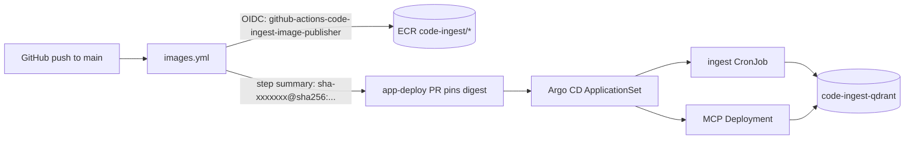

# ss-ai (EKS) Deployment Guide

> **Audience:** Internal Eco team
> **File:** `docs/deployment/SS_AI.md`
> **Chart:** `deploy/chart/code-ingest/`
> **CI:** `.github/workflows/images.yml`
> **Last Updated:** 2026-10-15

code-ingest runs on the ss-ai cluster (`eks-ss-ai-us-east-2-513051133833`, namespace `eco-ss-ai`) as:

| Component | Kind | Source |
|---|---|---|
| Ingestion | `CronJob` (daily 04:00 UTC) + repo-cache PVC | this repo's chart, image `code-ingest/ingest` |
| MCP server | `Deployment` + ClusterIP `Service` on 8001 | this repo's chart, image `code-ingest/mcp` |
| Qdrant | KubeBlocks `Cluster` `code-ingest-qdrant` + alias `Service` | app-deploy `extras/qdrant.yaml` |
| ECR repos, CI role, per-component Pod Identity, SecretProviderClasses | Crossplane / CSI | app-deploy `extras/` |

Argo CD's `app-deploy-ss-ai-513051133833` ApplicationSet picks the app up from
`eco/app-deploy` → `envs/ss-ai-513051133833/ai/code-ingest/config.json`, renders this
repo's chart at the pinned `targetRevision` with that directory's `values.yaml`, and
applies `extras/`. Nothing in nephos changes: the namespace, GitHub OIDC provider,
KubeBlocks, Secrets Store CSI and node pools already exist.



## Image CI

`.github/workflows/images.yml`:

- **Pull requests:**
  - Chart checks: `helm lint` and render guards. Renders must fail on a bare (undigested) tag, on the GitHub token wired into MCP, and on a secret file without a CSI mount. A hardened render must contain no `envFrom`, `secretKeyRef` or `Secret`.
  - Both images are built for `linux/amd64` (ss-ai nodes are x86_64).
  - Unit tests run inside each image under the pod's runtime constraints: UID 65532, read-only root, no capabilities.
  - The MCP entrypoint is booted the same way against a throwaway Qdrant, with its key read from a mounted file.
  - Nothing is pushed.
- **Push to `main` / manual dispatch on `main`:** the same steps, then assume `arn:aws:iam::513051133833:role/github-actions-code-ingest-image-publisher` via OIDC and push `513051133833.dkr.ecr.us-east-2.amazonaws.com/code-ingest/{ingest,mcp}:sha-<short>`.
  - The role trusts only `ref:refs/heads/main` of this repo.
  - Tags are IMMUTABLE; a re-run on the same commit skips the push.
  - The job summary prints the `sha-<short>@sha256:<digest>` to pin.
  - Each image carries `org.opencontainers.image.revision` (commit) and `org.opencontainers.image.url` (the run that built it), so a pinned digest traces back to its source.

`config/**` triggers a build because `repositories.yaml` and `collections.yaml` are baked into both images: changing the repo list means shipping a new image.

## Promoting a new version

1. Merge to `main`; wait for `images` to finish.
2. In `eco/app-deploy`, edit `envs/ss-ai-513051133833/ai/code-ingest/`:
   - `config.json` → `targetRevision`: the same commit SHA.
   - `values.yaml` → `images.mcp.tag` / `images.ingest.tag`: the two pinned references from the job summary. The chart schema rejects anything that is not `<tag>@sha256:<digest>`.

   Check provenance before pinning: `revision` must equal `targetRevision`, and `url` must be a successful `images` run on `main`.

   ```sh
   aws ecr get-login-password --profile ss-ai --region us-east-2 \
     | docker login --username AWS --password-stdin 513051133833.dkr.ecr.us-east-2.amazonaws.com
   docker buildx imagetools inspect \
     513051133833.dkr.ecr.us-east-2.amazonaws.com/code-ingest/mcp@sha256:<digest> \
     --format '{{json .Image.Config.Labels}}'
   ```
3. Merge; Argo CD syncs.

## First-time bootstrap

The ECR repositories and the CI role are themselves created by the app-deploy
Application, so the first rollout is two app-deploy PRs:

1. Seed AWS Secrets Manager (us-east-2, account 513051133833):
   - `eco/ss-ai/code-ingest/deepinfra-api-key`
   - `eco/ss-ai/code-ingest/github-token`: read access to every repo in `config/repositories.yaml`, across both `eco` and `eco-incorp`.
2. Merge the app-deploy PR that adds `ai/code-ingest/` with `mcp.enabled: false` and `ingest.enabled: false`. This syncs ECR, the CI role, Pod Identity, the SecretProviderClass and Qdrant.
3. Re-run `images` on `main` (Actions → images → Run workflow). The run from the merge that added the workflow fails at "Configure AWS credentials" because the role did not exist yet.
4. Second app-deploy PR: pin both image tags, set both `enabled: true`.
5. Trigger the first ingestion instead of waiting for 04:00 UTC:

```sh
kubectl -n eco-ss-ai create job code-ingest-ingest-manual-$(date +%s) --from=cronjob/code-ingest-ingest
```

## Runtime security

| Concern | How |
|---|---|
| Identity | One ServiceAccount per component (`code-ingest-mcp`, `code-ingest-ingest`), each with its own Pod Identity role; no Kubernetes API token is mounted |
| Credentials | Secrets Store CSI mounts files at `/mnt/secrets-store`. The chart sets `<VAR>_FILE` and `docker/load-secret-files.sh` exports `<VAR>` inside the container. No Kubernetes `Secret` is synced, so credentials are never in etcd or the pod spec |
| Least privilege | The MCP pod mounts only `deepinfra-api-key`; only the ingest pod gets `github-token`. The schema rejects `mcp.secretFiles.GITHUB_TOKEN` |
| Process | `runAsNonRoot` (UID/GID/fsGroup 65532), `readOnlyRootFilesystem`, `allowPrivilegeEscalation: false`, all capabilities dropped, `RuntimeDefault` seccomp |
| Writable paths | MCP: `/tmp` (emptyDir). Ingest: `/tmp` (emptyDir, also holds the per-run checkpoint), `/app/status` (emptyDir), `/app/repos` (PVC; discovery/relationship overlays under `/app/repos/.code-ingest-state`) |

## Using the MCP server

The service is ClusterIP only: the MCP server has no inbound auth and serves search over private repos, so it is not behind an ingress.

```sh
kubectl -n eco-ss-ai port-forward svc/code-ingest-mcp 8001:8001
# MCP client → http://localhost:8001/mcp
```

`/health` returns 503 (`waiting_for_ingestion`) until Qdrant holds points, so the pod stays NotReady until the first ingestion finishes. Liveness and startup probes check the TCP listener instead, so an empty store or a Qdrant outage never restarts the server.

## Chart values

`values.schema.json` validates every value and rejects unknown keys.

| Value | Default | Purpose |
|---|---|---|
| `images.{mcp,ingest}.repository` / `.tag` | — / `""` | Image reference; `tag` must be `<tag>@sha256:<digest>` and is required when the component is enabled |
| `qdrant.url` | `http://qdrant:6333` | Qdrant endpoint for both workloads |
| `embeddingModel` | `Qwen/Qwen3-Embedding-8B` | Must match between ingest and MCP |
| `podSecurityContext` / `securityContext` | non-root 65532, read-only root, caps dropped | Applied to both workloads |
| `{mcp,ingest}.secretProviderClass` | `""` | CSI SecretProviderClass mounted at `/mnt/secrets-store` |
| `{mcp,ingest}.secretFiles` | `{}` | `ENV_VAR: <object alias>` → sets `ENV_VAR_FILE`. MCP: `DEEPINFRA_API_KEY`, `QDRANT_API_KEY`. Ingest: those plus `GITHUB_TOKEN` |
| `mcp.enabled` / `ingest.enabled` | `true` | Toggle each workload |
| `ingest.schedule` / `timeZone` | `0 4 * * *` / `Etc/UTC` | CronJob schedule |
| `ingest.priority` | `low` | Minimum repo priority to clone and ingest |
| `ingest.activeDeadlineSeconds` | `21600` | Kill a run after 6h |
| `ingest.reposCache.*` | enabled, 50Gi | PVC at `/app/repos`; kept on uninstall and Argo prune. Disabled → emptyDir |

## Operational notes

- **Repo cache:** each run `git pull`s existing clones, then clones repos added to the config since the last run. Repos removed from the config stay on the volume but are not ingested.
- **Qdrant capacity:** vectors are 4096-d float32 held in RAM. The 6Gi limit on `code-ingest-qdrant` (the stateful pool's per-pod ceiling) holds roughly 300k chunks. If Qdrant OOMs, move collections to on-disk vectors rather than raising the limit.
- **Clone timeout:** the cloner allows 5 minutes per repo. `eco-incorp/sauce-recipes` is ~900 MB; if its first clone times out, the run continues without it and the next run retries.

## Related Documentation

- [Railway deployment](./RAILWAY.md)
- [Architecture overview](../architecture/OVERVIEW.md)
- [Data flow](../architecture/DATA_FLOW.md)
